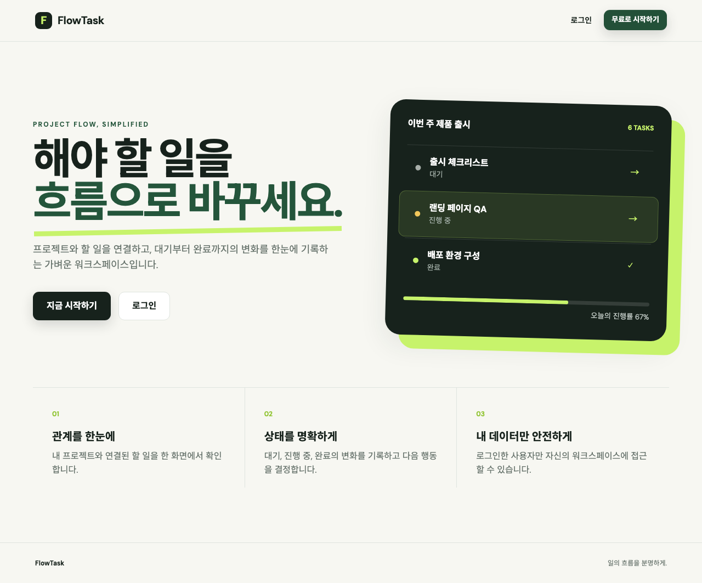
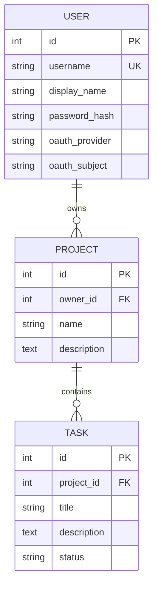
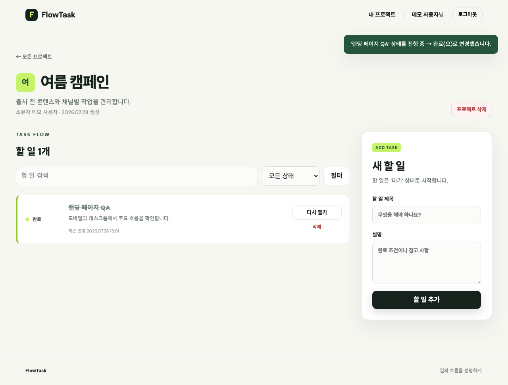

# FlowTask — 인증·인가와 연관관계 기반 할 일 관리 서비스

FastAPI의 `Depends` 기반 인증·인가, SQLAlchemy 연관관계, 상태 변경 비즈니스 로직을 하나의 사용자 흐름으로 구현한 Jinja2 SSR 웹 서비스이다. 사용자는 로그인 후 자신의 프로젝트와 할 일을 생성하고, 할 일 상태를 **대기 → 진행 중 → 완료**로 변경하거나 완료된 작업을 다시 열 수 있다.



## 주요 기능

- 서명된 세션 쿠키 기반 로그인·로그아웃
- PBKDF2-SHA256 비밀번호 해싱과 회원가입
- 비로그인 사용자의 보호 페이지 접근 차단
- 사용자별 프로젝트 소유권 검사
- `User → Project → Task` 연관관계 데이터 출력
- 서비스 계층에서 검증하는 할 일 상태 전이
- 프로젝트 검색, 할 일 검색·상태 필터
- GitHub OAuth2 Authorization Code Flow
- CSRF 토큰 검증과 일관된 전역 예외 화면
- 데스크톱·모바일 반응형 Jinja2 SSR UI

## 개발 환경

| 항목 | 버전 또는 선택 사항 |
| --- | --- |
| Python | 3.10 이상, 로컬 검증 3.14.5 |
| FastAPI | 0.116.1 |
| Uvicorn | 0.35.0 |
| SQLAlchemy | 2.0.41 |
| Jinja2 | 3.1.6 |
| python-multipart | 0.0.20 |
| itsdangerous | 2.2.0 |
| passlib | 1.7.4 |
| 데이터베이스 | SQLite |

과제에서 허용한 패키지만 사용했다. GitHub OAuth 토큰 교환은 추가 HTTP 라이브러리 없이 Python 표준 라이브러리 `urllib`로 구현했다.

## 인증 정보

| 항목 | 내용 |
| --- | --- |
| 인증 방식 | 서명된 세션 쿠키 |
| 선택 이유 | 브라우저 중심 Jinja2 SSR 서비스에서는 서버가 세션 상태를 확인하고 로그인 화면으로 리다이렉트하는 흐름이 자연스럽기 때문 |
| 세션 저장 정보 | 사용자 PK인 `user_id`만 저장 |
| 테스트 계정 ID | `demo` |
| 테스트 계정 PW | `demo1234` |
| 테스트 계정 저장 방식 | 애플리케이션 최초 시작 시 DB에 자동 생성 |
| 비밀번호 저장 | `passlib`의 PBKDF2-SHA256 단방향 해시 |

`SessionMiddleware`가 쿠키 서명과 변조 검증을 담당하고, `auth/dependencies.py`의 `require_user`가 `Depends`를 통해 보호 경로의 인증 여부를 확인한다. 로그인은 사용자의 신원을 확인하는 **인증**, 프로젝트 소유권 검사는 해당 데이터 접근 가능 여부를 판단하는 **인가**에 해당한다.

## 실행 방법

### macOS/Linux

```bash
python3 -m venv .venv
source .venv/bin/activate
pip install -r requirements.txt
uvicorn main:app --reload
```

### Windows

```powershell
python -m venv .venv
.venv\Scripts\activate
pip install -r requirements.txt
uvicorn main:app --reload
```

브라우저에서 <http://127.0.0.1:8000>에 접속한다. 첫 실행 시 `database.db`와 테스트 계정이 자동으로 생성된다.

운영 또는 공유 환경에서는 반드시 `APP_SECRET_KEY`를 긴 무작위 값으로 설정한다.

```bash
APP_SECRET_KEY='replace-with-a-random-secret' uvicorn main:app
```

지원하는 환경 변수는 [.env.example](.env.example)에서 확인할 수 있다.

## 공개·보호 경로 정책

| HTTP | 경로 | 정책 | 설명 |
| --- | --- | --- | --- |
| `GET` | `/` | 공개 | 로그인 상태에 따라 CTA와 메뉴가 달라지는 홈 |
| `GET`, `POST` | `/login` | 공개 | 로그인 화면과 인증 처리 |
| `GET`, `POST` | `/signup` | 공개 | 회원가입 화면과 계정 생성 |
| `GET` | `/auth/github` | 공개 | GitHub OAuth 인증 시작 |
| `GET` | `/auth/github/callback` | 공개 | OAuth state 검증 및 로그인 완료 |
| `GET` | `/health` | 공개 | 배포 상태 확인 |
| `GET` | `/docs`, `/redoc`, `/openapi.json` | 공개 | FastAPI 자동 API 문서 |
| `POST` | `/logout` | 보호 | 세션 제거 및 로그아웃 |
| 모든 메서드 | `/app/**` | 보호 | 프로젝트와 할 일 기능 |

비로그인 사용자가 `/app/**`에 접근하면 `AuthenticationRequired` 예외가 발생하고, 전역 예외 처리기가 원래 경로를 `next`에 담아 로그인 화면으로 이동시킨다.

## 주요 기능 경로

| 기능 | HTTP | 경로 |
| --- | --- | --- |
| 프로젝트 목록·검색 | `GET` | `/app/projects?q=검색어` |
| 프로젝트 생성 | `POST` | `/app/projects` |
| 프로젝트와 연결된 할 일 조회 | `GET` | `/app/projects/{project_id}` |
| 할 일 검색·필터 | `GET` | `/app/projects/{project_id}?q=검색어&status=completed` |
| 할 일 생성 | `POST` | `/app/projects/{project_id}/tasks` |
| 할 일 상태 변경 | `POST` | `/app/tasks/{task_id}/status` |
| 할 일 삭제 | `POST` | `/app/tasks/{task_id}/delete` |
| 프로젝트와 자식 할 일 삭제 | `POST` | `/app/projects/{project_id}/delete` |

## 데이터 모델과 연관관계



- `User.projects ↔ Project.owner`: 사용자 한 명이 여러 프로젝트를 소유하는 양방향 1:N 관계
- `Project.tasks ↔ Task.project`: 프로젝트 하나가 여러 할 일을 포함하는 양방향 1:N 관계
- 사용자 삭제 시 프로젝트, 프로젝트 삭제 시 할 일은 `cascade="all, delete-orphan"`와 DB `ON DELETE CASCADE`로 함께 삭제된다.
- 자식 데이터가 부모 없이 존재할 비즈니스 의미가 없으므로 cascade 정책을 선택했으며, 선택 이유를 모델 코드 주석으로 기록했다.
- N:M 관계는 사용하지 않았다.

## 상태 변경 비즈니스 로직

상태 변경 규칙은 라우터가 아니라 `services/task_service.py`에서 검증한다.

| 현재 상태 | 허용되는 다음 상태 | 화면 동작 |
| --- | --- | --- |
| 대기 (`todo`) | 진행 중 (`in_progress`) | 진행 시작 |
| 진행 중 (`in_progress`) | 완료 (`completed`), 대기 (`todo`) | 완료하기, 대기로 |
| 완료 (`completed`) | 대기 (`todo`) | 다시 열기 |

대기 상태에서 바로 완료하는 등 허용되지 않은 전이는 `AppError`로 차단한다. 성공한 상태 변경은 `대기 → 진행 중`과 같은 플래시 메시지와 카드 색상·버튼 변화로 즉시 확인할 수 있다.



## 코드 구조

```text
B5-3/
├── main.py                  # 앱 생성, 미들웨어, 전역 예외 처리
├── config.py                # 환경 변수 설정
├── database.py              # 엔진, 세션, SQLite FK 활성화
├── auth/                    # 인증 의존성, CSRF, GitHub OAuth
├── models/                  # User, Project, Task ORM 모델
├── repositories/            # DB 조회·저장·삭제
├── services/                # 인증과 상태 변경 비즈니스 규칙
├── routers/                 # 요청·응답과 화면 흐름
├── templates/               # Jinja2 SSR 화면
├── static/                  # 반응형 CSS
├── tests/                   # 도메인·HTTP 통합 검사
├── docs/screenshots/        # 제출용 실행 화면
├── render.yaml              # Render Blueprint
└── requirements.txt
```

## 보안 설계

- 비밀번호 원문을 저장하지 않고 PBKDF2-SHA256 해시만 저장한다.
- 서명된 세션에는 최소 정보인 사용자 ID만 저장한다.
- 모든 데이터 변경 폼에서 세션별 CSRF 토큰을 검증한다.
- OAuth 콜백에서 일회성 `state`를 상수 시간 비교해 로그인 CSRF를 차단한다.
- 프로젝트와 할 일 접근 전 소유자 ID를 검사한다.
- SQLite 연결마다 `PRAGMA foreign_keys=ON`을 적용한다.
- 운영 배포에서는 HTTPS 전용 세션 쿠키를 사용한다.
- 없는 데이터, 잘못된 접근, 인증 실패를 공통 예외 화면 또는 로그인 리다이렉트로 처리한다.

## GitHub 소셜 로그인 설정

1. GitHub의 **Settings → Developer settings → OAuth Apps**에서 OAuth App을 생성한다.
2. 로컬 개발의 Authorization callback URL을 `http://127.0.0.1:8000/auth/github/callback`으로 지정한다.
3. 발급받은 값을 환경 변수로 설정한다.

```bash
export GITHUB_CLIENT_ID='...'
export GITHUB_CLIENT_SECRET='...'
uvicorn main:app --reload
```

배포 환경에서는 콜백 URL을 `https://서비스주소/auth/github/callback`으로 변경한다. 클라이언트 비밀값은 저장소에 커밋하지 않는다.

## 테스트와 결과 확인

### 도메인 검사

```bash
.venv/bin/python tests/domain_checks.py
```

다음을 실제 SQLite DB에서 확인한다.

- 비밀번호 해시 저장
- `User → Project → Task` 두 개의 1:N 관계
- 허용·차단되는 상태 전이
- 사용자 삭제 시 프로젝트와 할 일 cascade 삭제

### HTTP 통합 검사

서버를 실행한 상태에서 다음 명령을 사용한다.

```bash
FLOWTASK_BASE_URL=http://127.0.0.1:8000 \
  .venv/bin/python tests/integration_smoke.py
```

익명 접근 차단, 로그인 성공·실패, 회원가입, 사용자별 인가, 프로젝트·할 일 생성, 상태 변경, 검색·필터, CSRF, 로그아웃, OAuth 미설정 오류, 404를 검증한다.

GitHub Actions는 push와 pull request마다 컴파일, 도메인 검사, HTTP 통합 검사를 실행한다. 브라우저 QA 결과와 증거 화면은 `.gstack/qa-reports/`에 저장되며 2026-07-28 기준 점수는 **100/100**이다.

## 외부 배포

저장소의 `render.yaml`은 Render 공식 FastAPI 구성에 맞춰 빌드 명령 `pip install -r requirements.txt`, 시작 명령 `uvicorn main:app --host 0.0.0.0 --port $PORT`, `/health` 상태 확인, HTTPS 전용 쿠키를 선언한다.

[](https://render.com/deploy?repo=https://github.com/myy-dev/B5-3)

배포 후 Render 환경 변수에 GitHub OAuth App의 `GITHUB_CLIENT_ID`, `GITHUB_CLIENT_SECRET`을 입력한다. 무료 Render 인스턴스의 로컬 SQLite 파일은 재배포 시 초기화될 수 있으므로 이 구성은 과제 시연용이다.

## 수행 항목 체크리스트

### 인증·인가와 UI

- [x] FastAPI `Depends` 기반 세션 인증
- [x] 로그인 성공·실패 안내와 로그아웃
- [x] DB 테스트 계정과 README ID/PW 명시
- [x] 공개·보호 경로 정책 표
- [x] 비로그인 보호 화면 접근 차단과 로그인 이동
- [x] 로그인 전·후 메뉴, 환영 문구, 버튼 변화
- [x] 인증 로직을 `auth/` 모듈로 분리

### 모델·연관관계·데이터

- [x] SQLAlchemy ORM 모델 3개
- [x] 1:N 관계 2개와 `back_populates` 양방향 관계
- [x] 관계 데이터를 DB에서 조회해 화면에 함께 출력
- [x] 부모 삭제 시 자식 처리 정책과 코드 주석
- [x] SQLite 관계형 DB에 모든 핵심 데이터 저장
- [x] N:M 관계 미사용

### 비즈니스 기능과 화면 흐름

- [x] 단순 CRUD를 넘는 상태 변경 기능
- [x] 상태 전이 규칙을 서비스 계층에 분리
- [x] 상태 변경 전·후를 메시지와 UI에서 확인
- [x] 로그인 → 기능 진입 → 생성·조회 → 상태 변경 → 결과 확인
- [x] 모든 주요 화면 Jinja2 SSR 렌더링

### 코드와 제출물

- [x] `auth`, `routers`, `services`, `repositories`, `models`, `templates` 역할 분리
- [x] Python·주요 패키지 버전
- [x] 가상환경·설치·실행 방법
- [x] 테스트 계정과 인증 방식 선택 이유
- [x] 공개·보호 정책과 주요 경로 목록
- [x] 전체 소스코드 GitHub 저장소
- [x] 데스크톱·모바일 실행 화면
- [x] 허용된 외부 패키지만 사용
- [x] 복잡한 역할 체계 없이 로그인 여부와 데이터 소유권만 검사

### 보너스

- [x] 커스텀 예외와 전역 예외 처리
- [x] 프로젝트 검색과 할 일 검색·상태 필터
- [x] GitHub OAuth2 Authorization Code Flow 구현
- [x] 회원가입과 비밀번호 해싱
- [x] Render Blueprint와 환경 변수 기반 배포 구성
- [ ] 외부 URL 배포 및 GitHub OAuth 실계정 최종 확인

## 학습 목표 설명

- **인증 흐름:** 로그인 폼 → `AuthService.authenticate` → 세션에 사용자 ID 저장 → `Depends(require_user)`가 후속 요청을 검증한다.
- **인가 흐름:** `ProjectService`와 `TaskService`가 현재 사용자 ID와 프로젝트 `owner_id`를 비교해 다른 사용자의 데이터를 차단한다.
- **객체 관계:** `User.projects`, `Project.owner`, `Project.tasks`, `Task.project`로 FK 데이터를 객체 그래프로 탐색한다.
- **상태 로직:** 상태 전이는 데이터 수정 이상의 도메인 규칙이므로 HTTP 라우터가 아닌 서비스 계층에서 허용 목록으로 관리한다.
- **전체 구조:** 라우터가 입력과 응답을 맡고, 서비스가 규칙을 적용하며, 저장소가 DB를 조작하고, Jinja2 화면이 사용자에게 결과를 전달한다.
