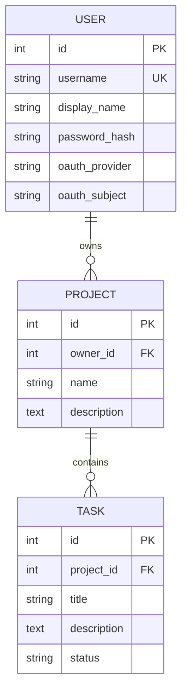

# 서비스 구조와 동작

[README로 돌아가기](../README.md)

## 주요 기능

- 서명된 세션 쿠키 기반 로그인·로그아웃
- PBKDF2-SHA256 비밀번호 해싱과 회원가입
- 비로그인 사용자의 보호 페이지 접근 차단
- 사용자별 프로젝트 소유권 검사
- `User → Project → Task` 연관관계 데이터 출력
- 서비스 계층에서 검증하는 할 일 상태 전이
- 프로젝트 검색, 할 일 검색·상태 필터
- GitHub OAuth2 Authorization Code Flow
- CSRF 토큰 검증과 일관된 전역 예외 화면
- 데스크톱·모바일 반응형 Jinja2 SSR UI

## 계층별 역할

| 계층 | 역할 | 주요 파일 |
| --- | --- | --- |
| 앱 구성 | 미들웨어, 라우터 등록, 시작 처리, 전역 예외 처리 | [main.py](../main.py) |
| 설정·DB | 환경 변수, 엔진, 세션, 테이블 생성 | [core/config.py](../core/config.py), [core/database.py](../core/database.py) |
| 공통 예외 | 인증·인가·도메인 오류 정의 | [core/exceptions.py](../core/exceptions.py) |
| 인증·인가 | 세션 사용자 조회, 보호 경로 검사, CSRF, OAuth 통신 | [auth/](../auth/) |
| 라우터 | 요청값 수신, 서비스 호출, 화면 응답과 리다이렉트 | [routers/](../routers/) |
| 서비스 | 입력 검증, 소유권 확인, 상태 전이 규칙 | [services/](../services/) |
| 저장소 | SQLAlchemy를 사용한 데이터 조회·변경 | [repositories/](../repositories/) |
| 모델 | 테이블, 외래 키, 양방향 연관관계 | [models/](../models/) |
| 화면 | 공통 템플릿 컨텍스트, Jinja2 SSR, 반응형 스타일 | [core/ui.py](../core/ui.py), [templates/](../templates/), [static/](../static/) |

## 인증과 접근 제어

`SessionMiddleware`가 쿠키 서명과 변조 검증을 담당한다. `auth/dependencies.py`의 `get_current_user_optional`은 세션의 `user_id`로 DB 사용자를 조회하고, `require_user`는 비로그인 요청에 `AuthenticationRequired` 예외를 발생시킨다. 보호 라우터는 `CurrentUser` 의존성을 사용한다.

로그인은 사용자의 신원을 확인하는 인증이다. `ProjectService.get_owned_project`는 소유자 ID를 비교해 다른 사용자의 프로젝트 접근을 차단하는 인가를 담당한다. 할 일 조회·변경도 연결된 프로젝트의 소유권을 확인한다.

비로그인 사용자가 보호 경로에 접근하면 전역 예외 처리기가 로그인 화면으로 이동시킨다. GET·HEAD 요청은 원래 경로를 `next`에 담고, 세션이 만료된 변경 요청은 로그인 후 프로젝트 목록으로 이동시킨다. 공개·보호 정책과 전체 기능 경로는 [경로와 접근 정책](routes.md)을 참고한다.

## 데이터 모델과 연관관계

- `User.projects ↔ Project.owner`: 사용자 한 명이 여러 프로젝트를 소유하는 양방향 1:N 관계
- `Project.tasks ↔ Task.project`: 프로젝트 하나가 여러 할 일을 포함하는 양방향 1:N 관계
- 사용자 삭제 시 프로젝트, 프로젝트 삭제 시 할 일은 `cascade="all, delete-orphan"`와 DB `ON DELETE CASCADE`로 함께 삭제된다.
- 자식 데이터가 부모 없이 존재할 비즈니스 의미가 없으므로 cascade 정책을 선택했으며, 선택 이유를 모델 코드 주석으로 기록했다.
- N:M 관계는 사용하지 않았다.

## 상태 변경 비즈니스 로직

상태 변경 규칙은 라우터가 아니라 `services/task_service.py`에서 검증한다.

| 현재 상태 | 허용되는 다음 상태 | 화면 동작 |
| --- | --- | --- |
| 대기 (`todo`) | 진행 중 (`in_progress`) | 진행 시작 |
| 진행 중 (`in_progress`) | 완료 (`completed`), 대기 (`todo`) | 완료하기, 대기로 |
| 완료 (`completed`) | 대기 (`todo`) | 다시 열기 |

대기 상태에서 바로 완료하는 등 허용되지 않은 전이는 `AppError`로 차단한다. 성공한 상태 변경은 `대기 → 진행 중`과 같은 플래시 메시지와 카드 색상·버튼 변화로 즉시 확인할 수 있다.

## 보안 설계

- 비밀번호 원문을 저장하지 않고 PBKDF2-SHA256 해시만 저장한다.
- 서명된 세션에는 최소 정보인 사용자 ID만 저장한다.
- 모든 데이터 변경 폼에서 세션별 CSRF 토큰을 검증한다.
- OAuth 콜백에서 일회성 `state`를 상수 시간 비교해 로그인 CSRF를 차단한다.
- 프로젝트와 할 일 접근 전 소유자 ID를 검사한다.
- SQLite 연결마다 `PRAGMA foreign_keys=ON`을 적용한다.
- 운영 배포에서는 HTTPS 전용 세션 쿠키를 사용한다.
- 없는 데이터, 잘못된 접근, 인증 실패를 공통 예외 화면 또는 로그인 리다이렉트로 처리한다.

GitHub OAuth 토큰 교환은 추가 HTTP 라이브러리 없이 Python 표준 라이브러리 `urllib`로 구현했다. 로그인 성공 시 기존 세션을 비우고 새 사용자 ID를 저장하며, 로그인 후 이동 경로는 내부 경로로 제한한다.

GitHub 로그인은 인증 시작 → 사용자 승인 → 콜백의 일회성 `state` 검증 → 인증 코드와 액세스 토큰 교환 → GitHub 사용자 조회 → 계정 생성 또는 조회 → 세션 시작 순서로 처리한다. GitHub 사용자는 공급자와 사용자 식별자 조합으로 연결하고, 액세스 토큰은 DB나 로그인 세션에 저장하지 않는다. 2026-11-07 사용자가 Render에서 실제 계정 로그인과 세션 유지를 직접 확인했으며, 결과는 [테스트와 검증](testing.md#github-소셜-로그인-실계정-검증)에 정리했다.

## 학습 목표 설명

- **인증 흐름:** 로그인 폼 → `AuthService.authenticate` → 세션에 사용자 ID 저장 → `Depends(require_user)`가 후속 요청을 검증한다.
- **인가 흐름:** `ProjectService`와 `TaskService`가 현재 사용자 ID와 프로젝트 `owner_id`를 비교해 다른 사용자의 데이터를 차단한다.
- **객체 관계:** `User.projects`, `Project.owner`, `Project.tasks`, `Task.project`로 FK 데이터를 객체 그래프로 탐색한다.
- **상태 로직:** 상태 전이는 데이터 수정 이상의 도메인 규칙이므로 HTTP 라우터가 아닌 서비스 계층에서 허용 목록으로 관리한다.
- **전체 구조:** 라우터가 입력과 응답을 맡고, 서비스가 규칙을 적용하며, 저장소가 DB를 조작하고, Jinja2 화면이 사용자에게 결과를 전달한다.
