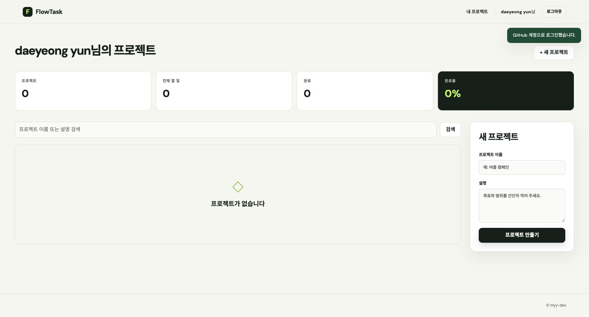

# 화면 자료

[README로 돌아가기](../README.md)

저장소에 포함된 실행 화면이다. 이후 UI 수정에 따라 현재 화면과 세부 문구·간격이 다를 수 있다.

## 홈

## 프로젝트 상세와 완료 상태

## 모바일 프로젝트

## GitHub 소셜 로그인

2026-11-04 이전 배포 환경에서 실제 GitHub 계정으로 로그인한 화면이다. 로그인 성공 안내, 계정 이름과 보호된 프로젝트 화면 진입을 확인했다. Render에서의 로그인·세션 유지 확인 결과는 [테스트와 검증](testing.md#github-소셜-로그인-실계정-검증)에 정리했다.

